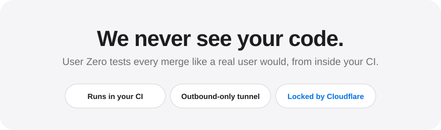
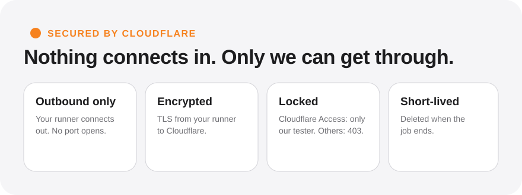

<div align="center">



# User Zero Action

**Tests every merge in your own CI, like a real user would, and tells you what's broken.**

[Quick start](#quick-start) · [What we see and never see](#what-we-see-and-never-see) · [How the tunnel is locked](#secured-by-cloudflare) · [Options](#more)

</div>

<br>

## How it works

| | |
|---|---|
| **1 &nbsp; Start** | Your workflow starts your app on `localhost`. |
| **2 &nbsp; Connect** | The action opens a secure, outbound-only tunnel to it. |
| **3 &nbsp; Test** | User Zero's tester signs in and uses the app, guided by the pull request. |
| **4 &nbsp; Report** | The bugs it finds go to the job summary and a comment on the pull request. |

## Quick start

> [!TIP]
> Three steps. Do a [dry run](#3-do-a-dry-run-first) first. It is free.

### 1. Add three secrets

| Secret | Where it comes from |
|---|---|
| `USERZERO_API_KEY` | The User Zero portal: **Settings → API keys** |
| `USERZERO_TEST_EMAIL` | A test user for your app |
| `USERZERO_TEST_PASSWORD` | That user's password |

### 2. Add the workflow

```yaml
name: User Zero
on:
  push:
    branches: [main]

jobs:
  test:
    runs-on: ubuntu-latest
    timeout-minutes: 90
    permissions:
      contents: read
      pull-requests: write
    steps:
      - uses: actions/checkout@v7

      # Start your app and leave it running (what your end-to-end tests already do).
      # Use the production build, without source maps, started in the background.
      - run: docker compose up -d --wait
        env:
          TEST_USER_EMAIL: ${{ secrets.USERZERO_TEST_EMAIL }}
          TEST_USER_PASSWORD: ${{ secrets.USERZERO_TEST_PASSWORD }}

      - uses: 0-user-zero/actions@v1
        with:
          api-key: ${{ secrets.USERZERO_API_KEY }}
          site: app.acme.com          # your site, as it is known in User Zero
          port: 3000                  # the port your app listens on
          login-email: ${{ secrets.USERZERO_TEST_EMAIL }}
          login-password: ${{ secrets.USERZERO_TEST_PASSWORD }}
```

The workflow above tests every merge to `main`. To test a pull request before it merges, add `pull_request:` under `on:` too (GitHub doesn't give secrets to pull requests from forks).

> [!IMPORTANT]
> **Your app must be running before the action.** The action doesn't start it.
> - Start it in the **background** (`docker compose up -d`, `npm start &`). A command that stays in the foreground blocks the job.
> - Start the **production build**, without source maps ([why](#build-it-like-production)).
> - Make it answer on **one `localhost` port**. The action waits up to 3 minutes.
> - Make your start-up **create the test user** from the two secrets above.

### 3. Do a dry run first

Add `dry-run: true` to the action step and run the workflow. It checks everything and tests nothing, so it's free. When it's green, remove the line.

Prefer not to write the start-up yourself? Paste [`SETUP_PROMPT.md`](SETUP_PROMPT.md) into your coding assistant and it writes the workflow for your repo.

## 🔒 Your code stays yours

> [!NOTE]
> **We don't see your code, and we don't want to.** User Zero tests your app the way a visitor would: through a browser. Your code never leaves your CI.

### What we see and never see

| What User Zero sees | What User Zero never sees |
|---|---|
| The pages your app serves to any visitor | Your repository and source files |
| The pull request's title and description | Your environment variables and secrets |
| The test user you give it | Your runner, its files and your network |

### Secured by Cloudflare



The tunnel is **[Cloudflare Tunnel](https://developers.cloudflare.com/cloudflare-one/networks/connectors/cloudflare-tunnel/)**, the same technology companies use to publish internal apps without opening their firewall.

- **Outbound only.** Your runner opens the connection to Cloudflare. Nothing connects in, and no port is opened. Cloudflare's own words: "cloudflared initiates an outbound connection through your firewall from the origin to the Cloudflare global network." <br>→ Cloudflare docs: [Cloudflare Tunnel](https://developers.cloudflare.com/cloudflare-one/networks/connectors/cloudflare-tunnel/) · [Tunnel with firewall](https://developers.cloudflare.com/cloudflare-one/networks/connectors/cloudflare-tunnel/configure-tunnels/tunnel-with-firewall/)
- **Encrypted.** Traffic runs over TLS between your runner and Cloudflare. <br>→ Cloudflare docs: [Tunnel cipher suites](https://developers.cloudflare.com/cloudflare-one/networks/connectors/cloudflare-tunnel/configure-tunnels/cipher-suites/)
- **Locked.** The address `ci-<id>.user-zero.com` is behind Cloudflare Access, which denies by default. Only User Zero's tester, who carries a service token, can open it. Anyone else gets a 403. <br>→ Cloudflare docs: [Cloudflare Access](https://developers.cloudflare.com/cloudflare-one/access-controls/) · [Access policies (deny by default)](https://developers.cloudflare.com/cloudflare-one/access-controls/policies/) · [Service tokens](https://developers.cloudflare.com/cloudflare-one/access-controls/service-credentials/service-tokens/)
- **Unguessable, and not relying on it.** The address contains 80 random bits, so it can't be guessed. But the address is not the lock: even someone who knew it would still be refused by Access.
- **Short-lived.** It exists for one session. When the job ends, the tunnel, its address and its access rule are deleted.

The tester only ever loads what a browser loads. It doesn't read or store your scripts.

### Build it like production

Start your app from a production build, and leave source maps out.

- **Safety.** Without source maps, the browser never receives your original source. It only gets what your real users get, minified.
- **Better tests.** A production build is what your users run. A dev server can hide bugs, or show ones that don't exist.

| Do | Don't |
|---|---|
| `npm run build` and `npm start` | A dev server (`npm run dev`) |
| Build without source maps | Publish `.map` files next to your scripts |
| Test-mode keys for third parties | Production secrets |


## The test login

- **You choose the test user.** Use a dedicated one, ideally the one your end-to-end tests use.
- **User Zero doesn't keep it.** It's encrypted until the session starts, then wiped, and never logged.
- **Email and password only.** Google sign-in, MFA codes and captchas can't be completed.

## Skip a merge

Not every merge needs a test. The action skips it, uses no credit, and says why in the job summary ("Not tested: …") when:

- **The pull request has the `no-qa` label.** Add it before you merge. Change the label with `skip-label`.
- **Only docs changed.** Merges that touch only `**/*.md`, `docs/**` or `.github/**` are skipped. Change the list with `ignore-paths`, for example `ignore-paths: "**/*.md,docs/**,.github/**,**/*.test.ts"`.

## More

<details>
<summary><b>All options</b></summary>

| Option | Default | |
|---|---|---|
| `api-key` | required | Your User Zero API key. |
| `site` | required | The site this repo is, as the host only (`app.acme.com`). |
| `port` | required | The port your app listens on in the job. |
| `login-email`, `login-password` | | The test user. |
| `dry-run` | `false` | Check the setup and stop. |
| `path` | `/` | The page to start from. |
| `scope` | | Extra instructions for the tester. |
| `fail-on` | `none` | `high` fails the job on critical or high bugs, `any` on any bug. |
| `comment` | `true` | Comment the results on the merged pull request. |
| `skip-label` | `no-qa` | Pull requests with this label aren't tested. |
| `ignore-paths` | `**/*.md,docs/**,.github/**` | Changes to only these files aren't tested. |
| `wait-timeout` | `180` | Seconds to wait for your app to answer. |

Outputs: `run-id`, `report-url`, `bug-count`, `dry-run`.

</details>

<details>
<summary><b>When something goes wrong</b></summary>

The log says what happened and what to change. The common ones:

| You see | Do this |
|---|---|
| *rejected the API key* | Check the `USERZERO_API_KEY` secret and that it's passed as `api-key`. |
| *is not approved for your account* | Use only the host in `site`, and ask us to approve it. |
| *Your app never answered* | Start it in the background and check the `port`. |
| *answered HTTP 404 on "/"* | Set `path` to a page that exists. |
| *answered HTTP 403 or 400 through the tunnel* | Allow the host `ci-*.user-zero.com` (Django `ALLOWED_HOSTS`, Rails `config.hosts`, Vite `server.allowedHosts`). |
| *The tester could not sign in* | Make your start-up create the user from the same two secrets. |
| *no run credits left* | Ask us for more credits. |
| *too many setup checks* | Dry runs are limited to 30 an hour. Wait a few minutes. |

</details>

<details>
<summary><b>Limits</b></summary>

- Linux runners only.
- Up to 10 sessions at once per account. Merges at the same moment run side by side. An 11th at the same time fails with a message, so tell us if your team merges that often.
- Your app must serve its frontend and API from one port. Calls to another `localhost` port from the browser fail.
- WebSockets aren't supported through the tunnel yet.

</details>
